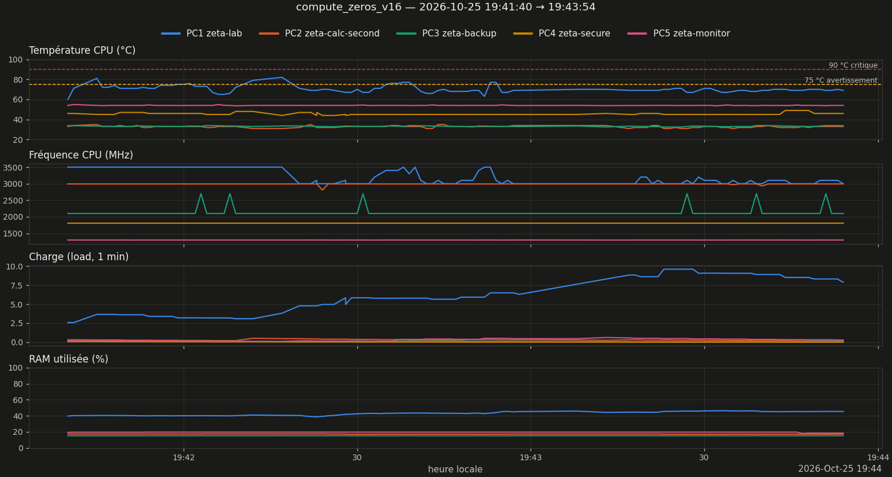

# Monitoring des runs — Zêta

Liste de chaque run lancé, avec ses graphiques (générée automatiquement par `zeta_mon_run.py` / `zeta_run_watch.py` / `zeta_run_report.py`). Chiffres **mesurés** ; interprétations marquées *hypothèse* dans chaque rapport ; section « Interprétation » rédigée après relecture.

## Runs de test

| Date | Run | Statut | Durée | Zéros | z/s | T max PC1 | Graphiques | Rapport · session |
|---|---|---|---|---|---|---|---|---|
| 2026-10-25 16:30 | T20000 | terminé | 0min46s | 22491 | 488.9 | 80.0 | [métriques](runs/test/20261025_163033_T20000/figures/metrics.png) · [zéros](runs/test/20261025_163033_T20000/figures/zeros_tranches.png) · [GUE](runs/test/20261025_163033_T20000/figures/gue.png) · [débit](runs/test/20261025_163033_T20000/figures/debit.png) | [MD](runs/test/20261025_163033_T20000/rapport.md) · [PDF](runs/test/20261025_163033_T20000/rapport.pdf) · [session](runs/test/20261025_163033_T20000/session.md) |
| 2026-10-25 14:29 | T20000 | terminé | 0min46s | 22491 | 488.9 | 79.0 | [métriques](runs/test/20261025_142919_T20000/figures/metrics.png) · [zéros](runs/test/20261025_142919_T20000/figures/zeros_tranches.png) · [GUE](runs/test/20261025_142919_T20000/figures/gue.png) · [débit](runs/test/20261025_142919_T20000/figures/debit.png) | [MD](runs/test/20261025_142919_T20000/rapport.md) · [PDF](runs/test/20261025_142919_T20000/rapport.pdf) · [session](runs/test/20261025_142919_T20000/session.md) |
| 2026-10-18 16:34 | T100000 | terminé | 2min32s | 138069 | 908.3 | 80.0 | [métriques](runs/test/20261018_163440_T100000/figures/metrics.png) · [zéros](runs/test/20261018_163440_T100000/figures/zeros_tranches.png) · [GUE](runs/test/20261018_163440_T100000/figures/gue.png) · [débit](runs/test/20261018_163440_T100000/figures/debit.png) | [MD](runs/test/20261018_163440_T100000/rapport.md) · [PDF](runs/test/20261018_163440_T100000/rapport.pdf) · [session](runs/test/20261018_163440_T100000/session.md) |
| 2026-10-18 16:28 | T100000 | terminé | 2min49s | 138069 | 817.0 | — | [zéros](runs/test/20261018_162803_T100000/figures/zeros_tranches.png) · [GUE](runs/test/20261018_162803_T100000/figures/gue.png) · [débit](runs/test/20261018_162803_T100000/figures/debit.png) | [MD](runs/test/20261018_162803_T100000/rapport.md) · [PDF](runs/test/20261018_162803_T100000/rapport.pdf) · [session](runs/test/20261018_162803_T100000/session.md) |
| 2026-10-17 20:19 | T100000 | terminé | 2min29s | 138069 | 926.6 | 79.0 | [métriques](runs/test/20261017_201929_T100000/figures/metrics.png) · [zéros](runs/test/20261017_201929_T100000/figures/zeros_tranches.png) · [GUE](runs/test/20261017_201929_T100000/figures/gue.png) · [débit](runs/test/20261017_201929_T100000/figures/debit.png) | [MD](runs/test/20261017_201929_T100000/rapport.md) · [PDF](runs/test/20261017_201929_T100000/rapport.pdf) · [session](runs/test/20261017_201929_T100000/session.md) |
| 2026-10-17 20:14 | T100000 | terminé | 2min28s | 138069 | 932.9 | 79.0 | [métriques](runs/test/20261017_201423_T100000/figures/metrics.png) · [zéros](runs/test/20261017_201423_T100000/figures/zeros_tranches.png) · [GUE](runs/test/20261017_201423_T100000/figures/gue.png) | [MD](runs/test/20261017_201423_T100000/rapport.md) · [PDF](runs/test/20261017_201423_T100000/rapport.pdf) · [session](runs/test/20261017_201423_T100000/session.md) |
| 2026-10-17 20:08 | T100000 | terminé | 2min43s | 138069 | 847.0 | 77.0 | [métriques](runs/test/20261017_200842_T100000/figures/metrics.png) · [zéros](runs/test/20261017_200842_T100000/figures/zeros_tranches.png) · [GUE](runs/test/20261017_200842_T100000/figures/gue.png) · [débit](runs/test/20261017_200842_T100000/figures/debit.png) | [MD](runs/test/20261017_200842_T100000/rapport.md) · [PDF](runs/test/20261017_200842_T100000/rapport.pdf) · [session](runs/test/20261017_200842_T100000/session.md) |
| 2026-10-17 17:59 | T100000 | terminé | 2min39s | 138069 | 868.4 | 79.0 | [métriques](runs/test/20261017_175939_T100000/figures/metrics.png) · [zéros](runs/test/20261017_175939_T100000/figures/zeros_tranches.png) · [GUE](runs/test/20261017_175939_T100000/figures/gue.png) · [débit](runs/test/20261017_175939_T100000/figures/debit.png) | [MD](runs/test/20261017_175939_T100000/rapport.md) · [PDF](runs/test/20261017_175939_T100000/rapport.pdf) · [session](runs/test/20261017_175939_T100000/session.md) |
| 2026-10-17 17:50 | T50000 | terminé | 2min16s | 63519 | 467.1 | 77.0 | [métriques](runs/test/20261017_175028_T50000/figures/metrics.png) · [zéros](runs/test/20261017_175028_T50000/figures/zeros_tranches.png) · [GUE](runs/test/20261017_175028_T50000/figures/gue.png) · [débit](runs/test/20261017_175028_T50000/figures/debit.png) | [MD](runs/test/20261017_175028_T50000/rapport.md) · [PDF](runs/test/20261017_175028_T50000/rapport.pdf) · [session](runs/test/20261017_175028_T50000/session.md) |

## Runs de production

| Date | Run | Statut | Durée | Zéros | z/s | T max PC1 | Graphiques | Rapport · session |
|---|---|---|---|---|---|---|---|---|
| 2026-11-03 09:54 | T400000 | terminé | 20min46s | 640526 | 514.1 | — | [zéros](runs/prod/20261103_095447_T400000/figures/zeros_tranches.png) · [GUE](runs/prod/20261103_095447_T400000/figures/gue.png) · [débit](runs/prod/20261103_095447_T400000/figures/debit.png) | [MD](runs/prod/20261103_095447_T400000/rapport.md) · [PDF](runs/prod/20261103_095447_T400000/rapport.pdf) · [session](runs/prod/20261103_095447_T400000/session.md) |
| 2026-11-03 09:28 | T400000 | abandonné (panne de batterie, relancé 09:54) | — | — | — | — | — | — |
| 2026-11-03 09:18 | T200000 | terminé | 6min24s | 298200 | 776.6 | — | [zéros](runs/prod/20261103_091845_T200000/figures/zeros_tranches.png) · [GUE](runs/prod/20261103_091845_T200000/figures/gue.png) · [débit](runs/prod/20261103_091845_T200000/figures/debit.png) | [MD](runs/prod/20261103_091845_T200000/rapport.md) · [PDF](runs/prod/20261103_091845_T200000/rapport.pdf) · [session](runs/prod/20261103_091845_T200000/session.md) |
| 2026-11-03 08:39 | T200000 | terminé | 6min36s | 298200 | 753.0 | — | [zéros](runs/prod/20261103_083954_T200000/figures/zeros_tranches.png) · [GUE](runs/prod/20261103_083954_T200000/figures/gue.png) · [débit](runs/prod/20261103_083954_T200000/figures/debit.png) | [MD](runs/prod/20261103_083954_T200000/rapport.md) · [PDF](runs/prod/20261103_083954_T200000/rapport.pdf) · [session](runs/prod/20261103_083954_T200000/session.md) |
| 2026-11-03 08:10 | T20000 | terminé | 0min56s | 22491 | 401.6 | — | [zéros](runs/prod/20261103_081015_T20000/figures/zeros_tranches.png) · [GUE](runs/prod/20261103_081015_T20000/figures/gue.png) · [débit](runs/prod/20261103_081015_T20000/figures/debit.png) | [MD](runs/prod/20261103_081015_T20000/rapport.md) · [PDF](runs/prod/20261103_081015_T20000/rapport.pdf) · [session](runs/prod/20261103_081015_T20000/session.md) |
| 2026-10-25 18:34 | T-off-neutre | terminé | 0min20s | — | — | — | — | [MD](runs/prod/20261025_183413_T-off-neutre/rapport.md) · [PDF](runs/prod/20261025_183413_T-off-neutre/rapport.pdf) · [session](runs/prod/20261025_183413_T-off-neutre/session.md) |
| 2026-10-25 18:30 | Tabc | échec (code 1) | 0min03s | — | — | 62.0 | [métriques](runs/prod/20261025_183054_Tabc/figures/metrics.png) | [MD](runs/prod/20261025_183054_Tabc/rapport.md) · [PDF](runs/prod/20261025_183054_Tabc/rapport.pdf) · [session](runs/prod/20261025_183054_Tabc/session.md) |
| 2026-10-25 18:27 | T20000 | échec (code 143) | 1min11s | — | — | 71.0 | [métriques](runs/prod/20261025_182706_T20000/figures/metrics.png) | [MD](runs/prod/20261025_182706_T20000/rapport.md) · [PDF](runs/prod/20261025_182706_T20000/rapport.pdf) · [session](runs/prod/20261025_182706_T20000/session.md) |
| 2026-10-25 18:23 | T20000 | échec (code 130) | 0min05s | — | — | 71.0 | [métriques](runs/prod/20261025_182335_T20000/figures/metrics.png) | [MD](runs/prod/20261025_182335_T20000/rapport.md) · [PDF](runs/prod/20261025_182335_T20000/rapport.pdf) · [session](runs/prod/20261025_182335_T20000/session.md) |
| 2026-10-25 18:06 | T-start-neutre | terminé | 0min10s | — | — | 57.0 | [métriques](runs/prod/20261025_180621_T-start-neutre/figures/metrics.png) | [MD](runs/prod/20261025_180621_T-start-neutre/rapport.md) · [PDF](runs/prod/20261025_180621_T-start-neutre/rapport.pdf) · [session](runs/prod/20261025_180621_T-start-neutre/session.md) |
| 2026-10-25 18:02 | T-exec-neutre | échec (code 3) | 0min16s | — | — | 48.0 | [métriques](runs/prod/20261025_180234_T-exec-neutre/figures/metrics.png) | [MD](runs/prod/20261025_180234_T-exec-neutre/rapport.md) · [PDF](runs/prod/20261025_180234_T-exec-neutre/rapport.pdf) · [session](runs/prod/20261025_180234_T-exec-neutre/session.md) |
| 2026-10-25 17:56 | T20000 | terminé | 0min38s | 22491 | 591.9 | 77.0 | [métriques](runs/prod/20261025_175651_T20000/figures/metrics.png) · [zéros](runs/prod/20261025_175651_T20000/figures/zeros_tranches.png) · [GUE](runs/prod/20261025_175651_T20000/figures/gue.png) · [débit](runs/prod/20261025_175651_T20000/figures/debit.png) | [MD](runs/prod/20261025_175651_T20000/rapport.md) · [PDF](runs/prod/20261025_175651_T20000/rapport.pdf) · [session](runs/prod/20261025_175651_T20000/session.md) |
| 2026-10-25 17:53 | T20000 | terminé | 0min37s | 22491 | 607.9 | 79.0 | [métriques](runs/prod/20261025_175355_T20000/figures/metrics.png) · [zéros](runs/prod/20261025_175355_T20000/figures/zeros_tranches.png) · [GUE](runs/prod/20261025_175355_T20000/figures/gue.png) | [MD](runs/prod/20261025_175355_T20000/rapport.md) · [PDF](runs/prod/20261025_175355_T20000/rapport.pdf) · [session](runs/prod/20261025_175355_T20000/session.md) |
| 2026-10-25 17:47 | T20000 | terminé | 0min38s | 22491 | 591.9 | 75.0 | [métriques](runs/prod/20261025_174705_T20000/figures/metrics.png) · [zéros](runs/prod/20261025_174705_T20000/figures/zeros_tranches.png) · [GUE](runs/prod/20261025_174705_T20000/figures/gue.png) | [MD](runs/prod/20261025_174705_T20000/rapport.md) · [PDF](runs/prod/20261025_174705_T20000/rapport.pdf) · [session](runs/prod/20261025_174705_T20000/session.md) |
| 2026-10-25 17:36 | T20000 | terminé | 0min36s | 22491 | 624.8 | 77.0 | [métriques](runs/prod/20261025_173624_T20000/figures/metrics.png) · [zéros](runs/prod/20261025_173624_T20000/figures/zeros_tranches.png) · [GUE](runs/prod/20261025_173624_T20000/figures/gue.png) | [MD](runs/prod/20261025_173624_T20000/rapport.md) · [PDF](runs/prod/20261025_173624_T20000/rapport.pdf) · [session](runs/prod/20261025_173624_T20000/session.md) |
| 2026-10-25 17:00 | T20000 | terminé | 0min43s | 22491 | 523.0 | 76.0 | [métriques](runs/prod/20261025_170037_T20000/figures/metrics.png) · [zéros](runs/prod/20261025_170037_T20000/figures/zeros_tranches.png) · [GUE](runs/prod/20261025_170037_T20000/figures/gue.png) · [débit](runs/prod/20261025_170037_T20000/figures/debit.png) | [MD](runs/prod/20261025_170037_T20000/rapport.md) · [PDF](runs/prod/20261025_170037_T20000/rapport.pdf) · [session](runs/prod/20261025_170037_T20000/session.md) |
| 2026-10-25 14:52 | T200000 | terminé | 6min10s | 298200 | 805.9 | 81.0 | [métriques](runs/prod/20261025_145223_T200000/figures/metrics.png) · [zéros](runs/prod/20261025_145223_T200000/figures/zeros_tranches.png) · [GUE](runs/prod/20261025_145223_T200000/figures/gue.png) · [débit](runs/prod/20261025_145223_T200000/figures/debit.png) | [MD](runs/prod/20261025_145223_T200000/rapport.md) · [PDF](runs/prod/20261025_145223_T200000/rapport.pdf) · [session](runs/prod/20261025_145223_T200000/session.md) |
| 2026-10-25 02:55 | T100000 | terminé | 2min18s | 138069 | 1000.5 | 79.0 | [métriques](runs/prod/20261025_025547_T100000/figures/metrics.png) · [zéros](runs/prod/20261025_025547_T100000/figures/zeros_tranches.png) · [GUE](runs/prod/20261025_025547_T100000/figures/gue.png) · [débit](runs/prod/20261025_025547_T100000/figures/debit.png) | [MD](runs/prod/20261025_025547_T100000/rapport.md) · [PDF](runs/prod/20261025_025547_T100000/rapport.pdf) · [session](runs/prod/20261025_025547_T100000/session.md) |
| 2026-10-25 02:49 | T200000 | terminé | 6min05s | 298200 | 817.0 | 80.0 | [métriques](runs/prod/20261025_024914_T200000/figures/metrics.png) · [zéros](runs/prod/20261025_024914_T200000/figures/zeros_tranches.png) · [GUE](runs/prod/20261025_024914_T200000/figures/gue.png) · [débit](runs/prod/20261025_024914_T200000/figures/debit.png) | [MD](runs/prod/20261025_024914_T200000/rapport.md) · [PDF](runs/prod/20261025_024914_T200000/rapport.pdf) · [session](runs/prod/20261025_024914_T200000/session.md) |
| 2026-10-25 02:27 | T100000 | terminé | 2min18s | 138069 | 1000.5 | 80.0 | [métriques](runs/prod/20261025_022754_T100000/figures/metrics.png) · [zéros](runs/prod/20261025_022754_T100000/figures/zeros_tranches.png) · [GUE](runs/prod/20261025_022754_T100000/figures/gue.png) · [débit](runs/prod/20261025_022754_T100000/figures/debit.png) | [MD](runs/prod/20261025_022754_T100000/rapport.md) · [PDF](runs/prod/20261025_022754_T100000/rapport.pdf) · [session](runs/prod/20261025_022754_T100000/session.md) |
| 2026-10-25 01:06 | T100000 | terminé | 2min17s | 138069 | 1007.8 | 79.0 | [métriques](runs/prod/20261025_010621_T100000/figures/metrics.png) · [zéros](runs/prod/20261025_010621_T100000/figures/zeros_tranches.png) · [GUE](runs/prod/20261025_010621_T100000/figures/gue.png) · [débit](runs/prod/20261025_010621_T100000/figures/debit.png) | [MD](runs/prod/20261025_010621_T100000/rapport.md) · [PDF](runs/prod/20261025_010621_T100000/rapport.pdf) · [session](runs/prod/20261025_010621_T100000/session.md) |
| 2026-10-24 22:59 | T100000 | terminé | 2min21s | 138069 | 979.2 | 79.0 | [métriques](runs/prod/20261024_225933_T100000/figures/metrics.png) · [zéros](runs/prod/20261024_225933_T100000/figures/zeros_tranches.png) · [GUE](runs/prod/20261024_225933_T100000/figures/gue.png) · [débit](runs/prod/20261024_225933_T100000/figures/debit.png) | [MD](runs/prod/20261024_225933_T100000/rapport.md) · [PDF](runs/prod/20261024_225933_T100000/rapport.pdf) · [session](runs/prod/20261024_225933_T100000/session.md) |
| 2026-10-24 22:56 | T20000 | terminé | 0min37s | 22491 | 607.9 | 77.0 | [métriques](runs/prod/20261024_225634_T20000/figures/metrics.png) · [zéros](runs/prod/20261024_225634_T20000/figures/zeros_tranches.png) · [GUE](runs/prod/20261024_225634_T20000/figures/gue.png) · [débit](runs/prod/20261024_225634_T20000/figures/debit.png) | [MD](runs/prod/20261024_225634_T20000/rapport.md) · [PDF](runs/prod/20261024_225634_T20000/rapport.pdf) · [session](runs/prod/20261024_225634_T20000/session.md) |
| 2026-10-24 22:47 | T5000 | terminé | 0min12s | 4520 | 376.7 | 65.0 | [métriques](runs/prod/20261024_224717_T5000/figures/metrics.png) · [zéros](runs/prod/20261024_224717_T5000/figures/zeros_tranches.png) · [GUE](runs/prod/20261024_224717_T5000/figures/gue.png) | [MD](runs/prod/20261024_224717_T5000/rapport.md) · [PDF](runs/prod/20261024_224717_T5000/rapport.pdf) · [session](runs/prod/20261024_224717_T5000/session.md) |
| 2026-10-18 18:18 | T100000 | terminé | 2min26s | 138069 | 945.7 | 70.0 | [métriques](runs/prod/20261018_181817_T100000/figures/metrics.png) · [zéros](runs/prod/20261018_181817_T100000/figures/zeros_tranches.png) · [GUE](runs/prod/20261018_181817_T100000/figures/gue.png) · [débit](runs/prod/20261018_181817_T100000/figures/debit.png) | [MD](runs/prod/20261018_181817_T100000/rapport.md) · [PDF](runs/prod/20261018_181817_T100000/rapport.pdf) · [session](runs/prod/20261018_181817_T100000/session.md) · [écran 1](runs/prod/20261018_181817_T100000/progress_rapport_20261018_181910.pdf) · [écran 2](runs/prod/20261018_181817_T100000/progress_rapport_20261018_181955.pdf) |
| 2026-10-18 18:14 | T100000 | terminé | 2min25s | 138069 | 952.2 | 69.0 | [métriques](runs/prod/20261018_181454_T100000/figures/metrics.png) · [zéros](runs/prod/20261018_181454_T100000/figures/zeros_tranches.png) · [GUE](runs/prod/20261018_181454_T100000/figures/gue.png) · [débit](runs/prod/20261018_181454_T100000/figures/debit.png) | [MD](runs/prod/20261018_181454_T100000/rapport.md) · [PDF](runs/prod/20261018_181454_T100000/rapport.pdf) · [session](runs/prod/20261018_181454_T100000/session.md) |
| 2026-10-17 20:59 | T400000 | terminé | 20min39s | 640520 | 517.0 | 79.0 | [métriques](runs/prod/20261017_205920_T400000/figures/metrics.png) · [zéros](runs/prod/20261017_205920_T400000/figures/zeros_tranches.png) · [GUE](runs/prod/20261017_205920_T400000/figures/gue.png) · [débit](runs/prod/20261017_205920_T400000/figures/debit.png) | [MD](runs/prod/20261017_205920_T400000/rapport.md) · [PDF](runs/prod/20261017_205920_T400000/rapport.pdf) · [session](runs/prod/20261017_205920_T400000/session.md) |
| 2026-10-17 20:55 | T10000 | terminé | 0min22s | 10142 | 461.0 | 73.0 | [métriques](runs/prod/20261017_205533_T10000/figures/metrics.png) · [zéros](runs/prod/20261017_205533_T10000/figures/zeros_tranches.png) · [GUE](runs/prod/20261017_205533_T10000/figures/gue.png) | [MD](runs/prod/20261017_205533_T10000/rapport.md) · [PDF](runs/prod/20261017_205533_T10000/rapport.pdf) · [session](runs/prod/20261017_205533_T10000/session.md) |
| 2026-10-17 20:49 | T100000 | terminé | 2min17s | 138069 | 1007.8 | 81.0 | [métriques](runs/prod/20261017_204949_T100000/figures/metrics.png) · [zéros](runs/prod/20261017_204949_T100000/figures/zeros_tranches.png) · [GUE](runs/prod/20261017_204949_T100000/figures/gue.png) | [MD](runs/prod/20261017_204949_T100000/rapport.md) · [PDF](runs/prod/20261017_204949_T100000/rapport.pdf) · [session](runs/prod/20261017_204949_T100000/session.md) |
| 2026-10-17 20:46 | T100000 | terminé | 2min27s | 138069 | 939.2 | 79.0 | [métriques](runs/prod/20261017_204619_T100000/figures/metrics.png) · [zéros](runs/prod/20261017_204619_T100000/figures/zeros_tranches.png) · [GUE](runs/prod/20261017_204619_T100000/figures/gue.png) | [MD](runs/prod/20261017_204619_T100000/rapport.md) · [PDF](runs/prod/20261017_204619_T100000/rapport.pdf) · [session](runs/prod/20261017_204619_T100000/session.md) |

## Runs détectés sans lanceur

| Date | Run | Statut | Durée | Zéros | z/s | T max PC1 | Graphiques | Rapport · session |
|---|---|---|---|---|---|---|---|---|
| 2026-10-25 19:41 | compute_zeros_v16 | terminé (code inconnu) | 2min14s | — | — | 82.0 | [métriques](runs/auto/20261025_194140_compute_zeros_v16/figures/metrics.png) | [MD](runs/auto/20261025_194140_compute_zeros_v16/rapport.md) · [PDF](runs/auto/20261025_194140_compute_zeros_v16/rapport.pdf) |
| 2026-10-25 19:41 | compute_zeros_v16 | terminé (code inconnu) | 0min22s | — | — | 76.0 | [métriques](runs/auto/20261025_194112_compute_zeros_v16/figures/metrics.png) | [MD](runs/auto/20261025_194112_compute_zeros_v16/rapport.md) · [PDF](runs/auto/20261025_194112_compute_zeros_v16/rapport.pdf) |
| 2026-10-25 19:39 | compute_zeros_v16 | terminé (code inconnu) | 1min01s | — | — | 82.0 | [métriques](runs/auto/20261025_193903_compute_zeros_v16/figures/metrics.png) | [MD](runs/auto/20261025_193903_compute_zeros_v16/rapport.md) · [PDF](runs/auto/20261025_193903_compute_zeros_v16/rapport.pdf) |
| 2026-10-25 19:38 | compute_zeros_v16 | terminé (code inconnu) | 0min20s | — | — | 76.0 | [métriques](runs/auto/20261025_193837_compute_zeros_v16/figures/metrics.png) | [MD](runs/auto/20261025_193837_compute_zeros_v16/rapport.md) · [PDF](runs/auto/20261025_193837_compute_zeros_v16/rapport.pdf) |
| 2026-10-25 19:38 | compute_zeros_v16 | terminé (code inconnu) | 0min20s | — | — | 71.0 | [métriques](runs/auto/20261025_193809_compute_zeros_v16/figures/metrics.png) | [MD](runs/auto/20261025_193809_compute_zeros_v16/rapport.md) · [PDF](runs/auto/20261025_193809_compute_zeros_v16/rapport.pdf) |
| 2026-10-25 19:15 | compute_zeros_v16 | terminé (code inconnu) | 0min32s | — | — | 77.0 | [métriques](runs/auto/20261025_191537_compute_zeros_v16/figures/metrics.png) | [MD](runs/auto/20261025_191537_compute_zeros_v16/rapport.md) · [PDF](runs/auto/20261025_191537_compute_zeros_v16/rapport.pdf) |
| 2026-10-25 19:13 | compute_zeros_v16 | terminé (code inconnu) | 0min15s | — | — | 68.0 | [métriques](runs/auto/20261025_191355_compute_zeros_v16/figures/metrics.png) | [MD](runs/auto/20261025_191355_compute_zeros_v16/rapport.md) · [PDF](runs/auto/20261025_191355_compute_zeros_v16/rapport.pdf) |
| 2026-10-25 18:09 | compute_zeros_v16 | terminé (code inconnu) | 0min09s | 4520 | 502.2 | 68.0 | [métriques](runs/auto/20261025_180928_compute_zeros_v16/figures/metrics.png) · [zéros](runs/auto/20261025_180928_compute_zeros_v16/figures/zeros_tranches.png) · [GUE](runs/auto/20261025_180928_compute_zeros_v16/figures/gue.png) | [MD](runs/auto/20261025_180928_compute_zeros_v16/rapport.md) · [PDF](runs/auto/20261025_180928_compute_zeros_v16/rapport.pdf) |
| 2026-10-24 22:38 | evince | terminé (code inconnu) | 0min28s | — | — | 59.0 | [métriques](runs/auto/20261024_223811_evince/figures/metrics.png) | [MD](runs/auto/20261024_223811_evince/rapport.md) · [PDF](runs/auto/20261024_223811_evince/rapport.pdf) |
| 2026-10-24 22:37 | eog | terminé (code inconnu) | 0min07s | — | — | 39.0 | [métriques](runs/auto/20261024_223758_eog/figures/metrics.png) | [MD](runs/auto/20261024_223758_eog/rapport.md) · [PDF](runs/auto/20261024_223758_eog/rapport.pdf) |
| 2026-10-24 22:10 | test_compute_zeros_v17 | terminé (code inconnu) | 0min15s | — | — | 61.0 | [métriques](runs/auto/20261024_221053_test_compute_zeros_v17/figures/metrics.png) | [MD](runs/auto/20261024_221053_test_compute_zeros_v17/rapport.md) · [PDF](runs/auto/20261024_221053_test_compute_zeros_v17/rapport.pdf) |

## Historique (sans mesures machines)

| Date | Run | Statut | Durée | Zéros | z/s | T max PC1 | Graphiques | Rapport · session |
|---|---|---|---|---|---|---|---|---|
| 2026-10-15 | T1b (t ∈ [4 900 000 ; 4 986 000]) — historique | historique (sans mesures machines) | — | 185810 | — | — | [zéros](runs/historique/20261015_T1b_historique/figures/zeros_tranches.png) · [GUE](runs/historique/20261015_T1b_historique/figures/gue.png) | — |

## Dernier run avec historique machines : compute_zeros_v16

## Galerie de référence (graphiques conservés)

Exemples **réels** de la séance du 2026-10-15 (T1b), pour savoir à quoi ressemble un run sain. La série machines est courte (quelques minutes) : illustration du format, pas une mesure de run.

*Suivi en direct des zéros (`zeta-live`) : colonnes bleu/gris + espacement de chaque zéro.*

*Espacements vs GUE (`zeta-gue`) : la répulsion des zéros, loin de Poisson.*

*Historique des 5 machines (`zeta-metrics`) : T°, fréquence, load, RAM.*

## Commandes (PC1)

- `zeta-mon-exec --nom N --type test|prod -- <commande>` : lance un run **avec** monitoring (fenêtres pour un test), code retour, rapport
- `zeta-mon-start` / `zeta-mon-stop --code N` : idem pour un run lancé à côté ; `zeta-mon-fenetres` / `zeta-mon-fermer`
- `zeta-mon-on` / `zeta-mon-off` / `zeta-mon-status` : logger machines 1 s + détecteur de secours
- `python scripts/zeta_run_progress.py` : tableau de bord en direct ; touche **r** = capture de l'écran + rapport MD/PDF expliquant l'écran de CE run, déposés dans `runs/<type>/<run>/progress_*` (run actif ; sans run actif : rien n'est écrit)
- `zeta-live` · `zeta-metrics` · `zeta-gue [--live]` · `zeta-report [run] [--lang en]` · `zeta-index`

---
*Monitoring-Runs.md · MAJ 2026-11-03 · 105 lignes*
