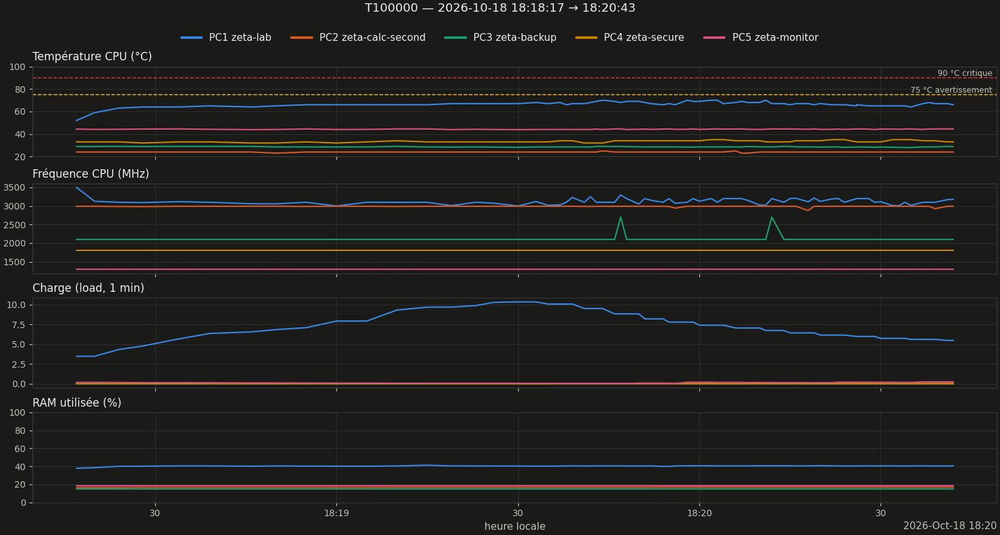

# Monitoring des runs — Zêta

Liste de chaque run lancé, avec ses graphiques (générée automatiquement par `zeta_mon_run.py` / `zeta_run_watch.py` / `zeta_run_report.py`). Chiffres **mesurés** ; interprétations marquées *hypothèse* dans chaque rapport ; section « Interprétation » rédigée après relecture.

## Runs de test

| Date | Run | Statut | Durée | Zéros | z/s | T max PC1 | Graphiques | Rapport · session |
|---|---|---|---|---|---|---|---|---|
| 2026-10-18 16:34 | T100000 | terminé | 2min32s | 138069 | 908.3 | 80.0 | [métriques](runs/test/20261018_163440_T100000/figures/metrics.png) · [zéros](runs/test/20261018_163440_T100000/figures/zeros_tranches.png) · [GUE](runs/test/20261018_163440_T100000/figures/gue.png) · [débit](runs/test/20261018_163440_T100000/figures/debit.png) | [MD](runs/test/20261018_163440_T100000/rapport.md) · [PDF](runs/test/20261018_163440_T100000/rapport.pdf) · [session](runs/test/20261018_163440_T100000/session.md) |
| 2026-10-18 16:28 | T100000 | terminé | 2min49s | 138069 | 817.0 | — | [zéros](runs/test/20261018_162803_T100000/figures/zeros_tranches.png) · [GUE](runs/test/20261018_162803_T100000/figures/gue.png) · [débit](runs/test/20261018_162803_T100000/figures/debit.png) | [MD](runs/test/20261018_162803_T100000/rapport.md) · [PDF](runs/test/20261018_162803_T100000/rapport.pdf) · [session](runs/test/20261018_162803_T100000/session.md) |
| 2026-10-17 20:19 | T100000 | terminé | 2min29s | 138069 | 926.6 | 79.0 | [métriques](runs/test/20261017_201929_T100000/figures/metrics.png) · [zéros](runs/test/20261017_201929_T100000/figures/zeros_tranches.png) · [GUE](runs/test/20261017_201929_T100000/figures/gue.png) · [débit](runs/test/20261017_201929_T100000/figures/debit.png) | [MD](runs/test/20261017_201929_T100000/rapport.md) · [PDF](runs/test/20261017_201929_T100000/rapport.pdf) · [session](runs/test/20261017_201929_T100000/session.md) |
| 2026-10-17 20:14 | T100000 | terminé | 2min28s | 138069 | 932.9 | 79.0 | [métriques](runs/test/20261017_201423_T100000/figures/metrics.png) · [zéros](runs/test/20261017_201423_T100000/figures/zeros_tranches.png) · [GUE](runs/test/20261017_201423_T100000/figures/gue.png) | [MD](runs/test/20261017_201423_T100000/rapport.md) · [PDF](runs/test/20261017_201423_T100000/rapport.pdf) · [session](runs/test/20261017_201423_T100000/session.md) |
| 2026-10-17 20:08 | T100000 | terminé | 2min43s | 138069 | 847.0 | 77.0 | [métriques](runs/test/20261017_200842_T100000/figures/metrics.png) · [zéros](runs/test/20261017_200842_T100000/figures/zeros_tranches.png) · [GUE](runs/test/20261017_200842_T100000/figures/gue.png) · [débit](runs/test/20261017_200842_T100000/figures/debit.png) | [MD](runs/test/20261017_200842_T100000/rapport.md) · [PDF](runs/test/20261017_200842_T100000/rapport.pdf) · [session](runs/test/20261017_200842_T100000/session.md) |
| 2026-10-17 17:59 | T100000 | terminé | 2min39s | 138069 | 868.4 | 79.0 | [métriques](runs/test/20261017_175939_T100000/figures/metrics.png) · [zéros](runs/test/20261017_175939_T100000/figures/zeros_tranches.png) · [GUE](runs/test/20261017_175939_T100000/figures/gue.png) · [débit](runs/test/20261017_175939_T100000/figures/debit.png) | [MD](runs/test/20261017_175939_T100000/rapport.md) · [PDF](runs/test/20261017_175939_T100000/rapport.pdf) · [session](runs/test/20261017_175939_T100000/session.md) |
| 2026-10-17 17:50 | T50000 | terminé | 2min16s | 63519 | 467.1 | 77.0 | [métriques](runs/test/20261017_175028_T50000/figures/metrics.png) · [zéros](runs/test/20261017_175028_T50000/figures/zeros_tranches.png) · [GUE](runs/test/20261017_175028_T50000/figures/gue.png) · [débit](runs/test/20261017_175028_T50000/figures/debit.png) | [MD](runs/test/20261017_175028_T50000/rapport.md) · [PDF](runs/test/20261017_175028_T50000/rapport.pdf) · [session](runs/test/20261017_175028_T50000/session.md) |

## Runs de production

| Date | Run | Statut | Durée | Zéros | z/s | T max PC1 | Graphiques | Rapport · session |
|---|---|---|---|---|---|---|---|---|
| 2026-10-18 18:18 | T100000 | terminé | 2min26s | 138069 | 945.7 | 70.0 | [métriques](runs/prod/20261018_181817_T100000/figures/metrics.png) · [zéros](runs/prod/20261018_181817_T100000/figures/zeros_tranches.png) · [GUE](runs/prod/20261018_181817_T100000/figures/gue.png) · [débit](runs/prod/20261018_181817_T100000/figures/debit.png) | [MD](runs/prod/20261018_181817_T100000/rapport.md) · [PDF](runs/prod/20261018_181817_T100000/rapport.pdf) · [session](runs/prod/20261018_181817_T100000/session.md) · [écran 1](runs/prod/20261018_181817_T100000/progress_rapport_20261018_181910.pdf) · [écran 2](runs/prod/20261018_181817_T100000/progress_rapport_20261018_181955.pdf) |
| 2026-10-18 18:14 | T100000 | terminé | 2min25s | 138069 | 952.2 | 69.0 | [métriques](runs/prod/20261018_181454_T100000/figures/metrics.png) · [zéros](runs/prod/20261018_181454_T100000/figures/zeros_tranches.png) · [GUE](runs/prod/20261018_181454_T100000/figures/gue.png) · [débit](runs/prod/20261018_181454_T100000/figures/debit.png) | [MD](runs/prod/20261018_181454_T100000/rapport.md) · [PDF](runs/prod/20261018_181454_T100000/rapport.pdf) · [session](runs/prod/20261018_181454_T100000/session.md) |
| 2026-10-17 20:59 | T400000 | terminé | 20min39s | 640520 | 517.0 | 79.0 | [métriques](runs/prod/20261017_205920_T400000/figures/metrics.png) · [zéros](runs/prod/20261017_205920_T400000/figures/zeros_tranches.png) · [GUE](runs/prod/20261017_205920_T400000/figures/gue.png) · [débit](runs/prod/20261017_205920_T400000/figures/debit.png) | [MD](runs/prod/20261017_205920_T400000/rapport.md) · [PDF](runs/prod/20261017_205920_T400000/rapport.pdf) · [session](runs/prod/20261017_205920_T400000/session.md) |
| 2026-10-17 20:55 | T10000 | terminé | 0min22s | 10142 | 461.0 | 73.0 | [métriques](runs/prod/20261017_205533_T10000/figures/metrics.png) · [zéros](runs/prod/20261017_205533_T10000/figures/zeros_tranches.png) · [GUE](runs/prod/20261017_205533_T10000/figures/gue.png) | [MD](runs/prod/20261017_205533_T10000/rapport.md) · [PDF](runs/prod/20261017_205533_T10000/rapport.pdf) · [session](runs/prod/20261017_205533_T10000/session.md) |
| 2026-10-17 20:49 | T100000 | terminé | 2min17s | 138069 | 1007.8 | 81.0 | [métriques](runs/prod/20261017_204949_T100000/figures/metrics.png) · [zéros](runs/prod/20261017_204949_T100000/figures/zeros_tranches.png) · [GUE](runs/prod/20261017_204949_T100000/figures/gue.png) | [MD](runs/prod/20261017_204949_T100000/rapport.md) · [PDF](runs/prod/20261017_204949_T100000/rapport.pdf) · [session](runs/prod/20261017_204949_T100000/session.md) |
| 2026-10-17 20:46 | T100000 | terminé | 2min27s | 138069 | 939.2 | 79.0 | [métriques](runs/prod/20261017_204619_T100000/figures/metrics.png) · [zéros](runs/prod/20261017_204619_T100000/figures/zeros_tranches.png) · [GUE](runs/prod/20261017_204619_T100000/figures/gue.png) | [MD](runs/prod/20261017_204619_T100000/rapport.md) · [PDF](runs/prod/20261017_204619_T100000/rapport.pdf) · [session](runs/prod/20261017_204619_T100000/session.md) |

## Historique (sans mesures machines)

| Date | Run | Statut | Durée | Zéros | z/s | T max PC1 | Graphiques | Rapport · session |
|---|---|---|---|---|---|---|---|---|
| 2026-10-15 | T1b (t ∈ [4 900 000 ; 4 986 000]) — historique | historique (sans mesures machines) | — | 185810 | — | — | [zéros](runs/historique/20261015_T1b_historique/figures/zeros_tranches.png) · [GUE](runs/historique/20261015_T1b_historique/figures/gue.png) | — |

## Dernier run avec historique machines : T100000

## Galerie de référence (graphiques conservés)

Exemples **réels** de la séance du 2026-10-15 (T1b), pour savoir à quoi ressemble un run sain. La série machines est courte (quelques minutes) : illustration du format, pas une mesure de run.

*Suivi en direct des zéros (`zeta-live`) : colonnes bleu/gris + espacement de chaque zéro.*

*Espacements vs GUE (`zeta-gue`) : la répulsion des zéros, loin de Poisson.*

*Historique des 5 machines (`zeta-metrics`) : T°, fréquence, load, RAM.*

## Commandes (PC1)

- `zeta-mon-exec --nom N --type test|prod -- <commande>` : lance un run **avec** monitoring (fenêtres pour un test), code retour, rapport
- `zeta-mon-start` / `zeta-mon-stop --code N` : idem pour un run lancé à côté ; `zeta-mon-fenetres` / `zeta-mon-fermer`
- `zeta-mon-on` / `zeta-mon-off` / `zeta-mon-status` : logger machines 1 s + détecteur de secours
- `python scripts/zeta_run_progress.py` : tableau de bord en direct ; touche **r** = capture de l'écran + rapport MD/PDF expliquant l'écran de CE run, déposés dans `runs/<type>/<run>/progress_*` (run actif ; sans run actif : rien n'est écrit)
- `zeta-live` · `zeta-metrics` · `zeta-gue [--live]` · `zeta-report [run] [--lang en]` · `zeta-index`

---
*Monitoring-Runs.md · MAJ 2026-10-18 · 65 lignes*
