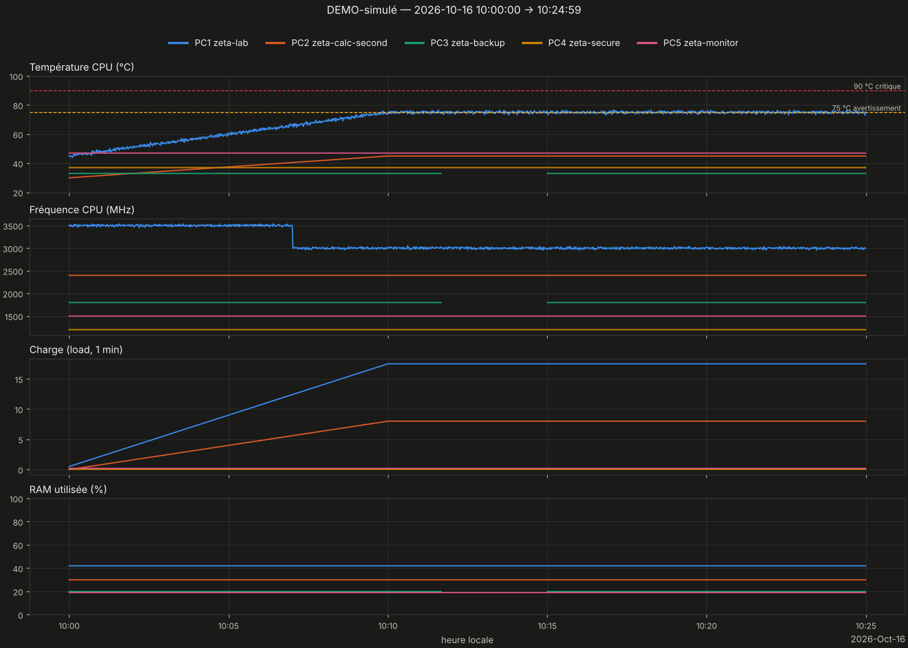
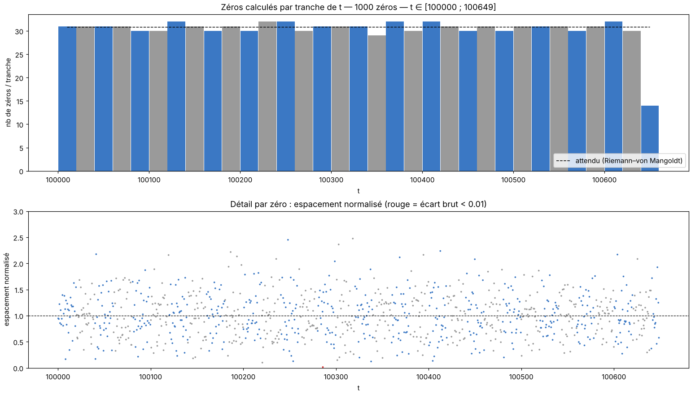
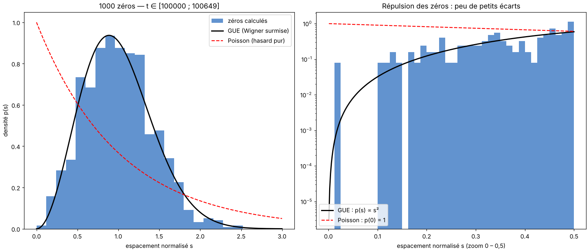

# Rapport de monitoring — run DEMO-simulé

**⚠ DONNÉES SIMULÉES — DÉMONSTRATION DU FORMAT. Ne pas interpréter.**

Légende : **[mesuré]** = chiffre lu dans les données ; **[heuristique]** / **[hypothèse]** = interprétation non vérifiée ; **[conjecture]** = résultat non démontré.

## 1. Résumé

| Grandeur | Valeur |
|---|---|
| Run | 20261016_100000_demo |
| Début / fin | 2026-10-16 10:00:00 → 10:24:59 |
| Durée | 24min59s |
| Commande (extrait) | `python compute_zeros_v16.py --demo` |
| CSV des zéros | `zeros_fake.csv` |
| Zéros dans le CSV | 1000  [mesuré] |
| t min → t max | 100000.000 → 100648.765 |
| Débit moyen (zéros / durée du run) | 0.7 /s |

## 2. Machines pendant le run

*Figure 1 — Température, fréquence, charge et RAM des 5 machines (1 mesure/s).*

| Machine | Valides | T moy °C | T max °C | % ≥ 75 °C | MHz min–max | load max | RAM max % |
|---|---|---|---|---|---|---|---|
| PC1 zeta-lab | 100 % | 69.0 | 76.7 | 32 | 2958–3537 | 17.50 | 42.0 |
| PC2 zeta-calc-second | 100 % | 42.0 | 45.0 | 0 | 2400–2400 | 8.00 | 30.0 |
| PC3 zeta-backup | 87 % | 33.0 | 33.0 | 0 | 1800–1800 | 0.10 | 20.0 |
| PC4 zeta-secure | 100 % | 37.0 | 37.0 | 0 | 1200–1200 | 0.05 | — |
| PC5 zeta-monitor | 100 % | 47.0 | 47.0 | 0 | 1500–1500 | 0.20 | 19.0 |

### Observations

- PC1 : température max 76.7 °C, 32 % du temps ≥ 75 °C (seuil d'avertissement) [mesuré]
- PC3 : seulement 87 % de mesures valides (machine éteinte, SSH coupé ou capteur absent) [mesuré]
- PC1 : fréquence médiane 3501 MHz sur le 1ᵉʳ cinquième du run, 3000 MHz sur le dernier [mesuré]

- La baisse de fréquence PC1 coïncide avec T ≥ 75 °C : compatible avec une limitation thermique [hypothèse — à confirmer, une limite de puissance donne le même symptôme].

## 3. Zéros calculés

*Figure 2 — Haut : zéros par tranche de t (bleu/gris alternés) vs densité théorique ln(t/2π)/2π. Bas : espacement normalisé de chaque zéro.*

Comptage : 1000 zéros dans le CSV ; formule de Riemann–von Mangoldt (sans terme S(t)) : ≈ 1000.3. Écart -0.3. **[heuristique]** un écart de quelques unités est normal ; un écart de plusieurs dizaines suggère des zéros manquants ou en double. **Ce n'est pas une validation : la complétude se prouve par Turing–Backlund, hors de ce rapport.**

*Figure 3 — Espacements normalisés vs GUE (Wigner surmise) et Poisson ; à droite zoom sur la répulsion (échelle log).*

| Grandeur | Mesuré | Référence |
|---|---|---|
| Moyenne de s | 1.0003 | 1 (par construction) |
| Variance de s | 0.1703 | GUE ≈ 0.18 ; Poisson = 1 |
| Part s < 0,1 | 0.100 % | GUE surmise ≈ 0.11 % ; Poisson ≈ 9.5 % |
| Plus petit écart brut | 0.009219 | — |

**[conjecture, Montgomery–Odlyzko]** les espacements suivent la loi GUE ; ici la répulsion est nette. La variance un peu sous 0,18 sur de petites hauteurs relève des corrections de taille finie **[hypothèse]**. Avec peu de zéros (< quelques milliers) l'histogramme est bruité : ne pas sur-interpréter.

## 4. Limites

- Mesures toutes les ~1 s (SSH) : les pics plus courts échappent ; PC4 (OpenBSD) n'a pas de mesure de RAM.
- Début/fin du run = apparition/disparition du processus détecté, à quelques secondes près.
- Au-delà de 8 000 points par machine, le tracé est sous-échantillonné (les statistiques utilisent toutes les mesures).

---
*rapport.md · MAJ 2026-10-16 · 70 lignes*
