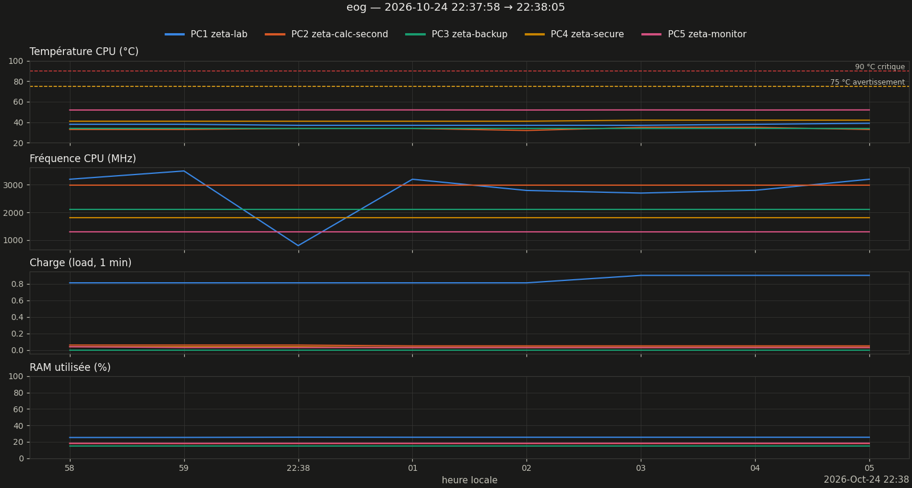

# Rapport de monitoring — run eog

Légende : **[mesuré]** = chiffre lu dans les données ; **[heuristique]** / **[hypothèse]** = interprétation non vérifiée ; **[conjecture]** = résultat non démontré.

Validation Turing–Backlund : verdict introuvable (journal `execution_*.log` absent ou illisible) [non vérifié].

## 1. Résumé

| Grandeur | Valeur |
|---|---|
| Run | 20261024_223758_eog  (auto) |
| Début / fin | 2026-10-24 22:37:58 → 22:38:05 |
| Durée | 0min07s |
| Commande (extrait) | `/usr/bin/eog /home/riemann/projet_zeta/monitoring/runs/auto/20261024_221053_test_compute_z` |
| Code retour | inconnu (run non lancé par le lanceur) |
| Turbo CPU début → fin | ? → ? |
| CSV des zéros | `introuvable` |
| Turing–Backlund | inconnu |

## 2. Machines pendant le run

*Figure 1 — Température, fréquence, charge et RAM des 5 machines (1 mesure/s).*

| Machine | Valides | T moy °C | T max °C | % ≥ 75 °C | MHz min–max | load max | RAM max % |
|---|---|---|---|---|---|---|---|
| PC1 zeta-lab | 100 % | 37.6 | 39.0 | 0 | 800–3500 | 0.90 | 25.6 |
| PC2 zeta-calc-second | 100 % | 33.6 | 35.0 | 0 | 2992–2992 | 0.06 | 17.9 |
| PC3 zeta-backup | 100 % | 34.0 | 34.0 | 0 | 2100–2100 | 0.00 | 15.2 |
| PC4 zeta-secure | 100 % | 41.4 | 42.0 | 0 | 1800–1800 | 0.04 | — |
| PC5 zeta-monitor | 100 % | 52.0 | 52.0 | 0 | 1297–1299 | 0.04 | 18.2 |

### Observations

- Rien d'anormal détecté sur les seuils automatiques [mesuré].

## 3. Zéros calculés

CSV des zéros introuvable ou trop court : sections 3 non générées. Relancer `zeta-report` après `zeta-run-hint NOM CSV`.

## 5. Interprétation

*Pas encore rédigée. Après relecture des observations, créer `interpretation.md` dans ce dossier puis `zeta-report` : distinguer mesuré / heuristique / hypothèse / conjecture.*

## 6. Limites

- Mesures toutes les ~1 s (SSH) : les pics plus courts échappent ; PC4 (OpenBSD) n'a pas de mesure de RAM.
- Début/fin du run = apparition/disparition du processus détecté, à quelques secondes près.
- Au-delà de 8 000 points par machine, le tracé est sous-échantillonné (les statistiques utilisent toutes les mesures).

---
*rapport.md · MAJ 2026-10-24 · 53 lignes*
