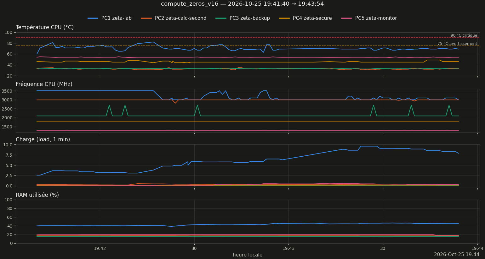

# Rapport de monitoring — run compute_zeros_v16

Légende : **[mesuré]** = chiffre lu dans les données ; **[heuristique]** / **[hypothèse]** = interprétation non vérifiée ; **[conjecture]** = résultat non démontré.

Validation Turing–Backlund : verdict introuvable (journal `execution_*.log` absent ou illisible) [non vérifié].

## 1. Résumé

| Grandeur | Valeur |
|---|---|
| Run | 20261025_194140_compute_zeros_v16  (auto) |
| Début / fin | 2026-10-25 19:41:40 → 19:43:54 |
| Durée | 2min14s |
| Commande (extrait) | `/home/riemann/projet_zeta/zeta_env/bin/python /home/riemann/projet_zeta/src/calculs/optimi` |
| Code retour | inconnu (run non lancé par le lanceur) |
| Turbo CPU début → fin | ? → ? |
| CSV des zéros | `introuvable` |
| Turing–Backlund | inconnu |

## 2. Machines pendant le run

*Figure 1 — Température, fréquence, charge et RAM des 5 machines (1 mesure/s).*

| Machine | Valides | T moy °C | T max °C | % ≥ 75 °C | MHz min–max | load max | RAM max % |
|---|---|---|---|---|---|---|---|
| PC1 zeta-lab | 100 % | 70.2 | 82.0 | 12 | 3000–3501 | 9.60 | 46.3 |
| PC2 zeta-calc-second | 100 % | 32.8 | 35.0 | 0 | 2808–2992 | 0.52 | 17.4 |
| PC3 zeta-backup | 100 % | 33.2 | 34.0 | 0 | 2100–2700 | 0.17 | 15.2 |
| PC4 zeta-secure | 100 % | 45.5 | 49.0 | 0 | 1800–1800 | 0.08 | — |
| PC5 zeta-monitor | 100 % | 54.0 | 54.9 | 0 | 1297–1299 | 0.62 | 19.6 |

### Observations

- PC1 : température max 82.0 °C, 12 % du temps ≥ 75 °C (seuil d'avertissement) [mesuré]
- PC1 : fréquence médiane 3500 MHz sur le 1ᵉʳ cinquième du run, 3000 MHz sur le dernier [mesuré]

- La baisse de fréquence PC1 coïncide avec T ≥ 75 °C : compatible avec une limitation thermique [hypothèse — à confirmer, une limite de puissance donne le même symptôme].

## 3. Zéros calculés

CSV des zéros introuvable ou trop court : sections 3 non générées. Relancer `zeta-report` après `zeta-run-hint NOM CSV`.

## 5. Interprétation

*Pas encore rédigée. Après relecture des observations, créer `interpretation.md` dans ce dossier puis `zeta-report` : distinguer mesuré / heuristique / hypothèse / conjecture.*

## 6. Limites

- Mesures toutes les ~1 s (SSH) : les pics plus courts échappent ; PC4 (OpenBSD) n'a pas de mesure de RAM.
- Début/fin du run = apparition/disparition du processus détecté, à quelques secondes près.
- Au-delà de 8 000 points par machine, le tracé est sous-échantillonné (les statistiques utilisent toutes les mesures).

---
*rapport.md · MAJ 2026-10-25 · 56 lignes*
