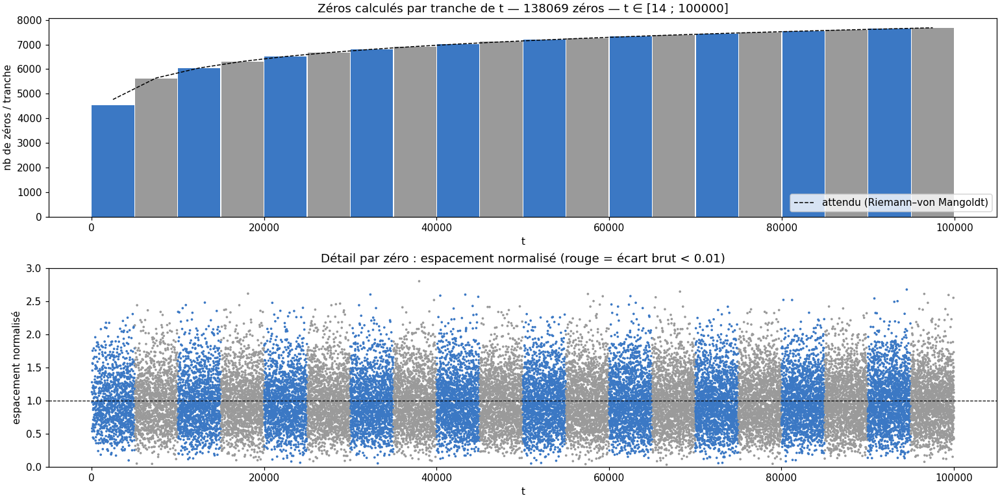

# Rapport de monitoring — run T100000

Légende : **[mesuré]** = chiffre lu dans les données ; **[heuristique]** / **[hypothèse]** = interprétation non vérifiée ; **[conjecture]** = résultat non démontré.

**Validation Turing–Backlund : ✅ COMPLET** [mesuré, lu dans execution_v16_T100000_20261017_204620.log] — vérification numérique, pas une certification.

## 1. Résumé

| Grandeur | Valeur |
|---|---|
| Run | 20261017_204619_T100000  (prod) |
| Début / fin | 2026-10-17 20:46:19 → 20:48:46 |
| Durée | 2min27s |
| Commande (extrait) | `bash -c printf '100000\nO\n' \| python /home/riemann/projet_zeta/src/calculs/optimisation/c` |
| Code retour | 0 |
| Turbo CPU début → fin | actif (intel_pstate) → actif (intel_pstate) |
| CSV des zéros | `zeros_v16_T100000_20261017_204620.csv` |
| Turing–Backlund | ✅ COMPLET |
| Zéros dans le CSV | 138069  [mesuré] |
| t min → t max | 14.135 → 99999.701 |
| Débit moyen (zéros / durée du run) | 939.2 /s |

## 2. Machines pendant le run

*Figure 1 — Température, fréquence, charge et RAM des 5 machines (1 mesure/s).*

| Machine | Valides | T moy °C | T max °C | % ≥ 75 °C | MHz min–max | load max | RAM max % |
|---|---|---|---|---|---|---|---|
| PC1 zeta-lab | 100 % | 70.5 | 79.0 | 15 | 3000–3500 | 12.63 | 44.0 |
| PC2 zeta-calc-second | 100 % | 25.0 | 26.0 | 0 | 2839–2993 | 0.08 | 16.9 |
| PC3 zeta-backup | 100 % | 29.8 | 30.5 | 0 | 1500–2700 | 0.12 | 15.2 |
| PC4 zeta-secure | 100 % | 34.6 | 36.0 | 0 | 1800–1800 | 0.15 | — |
| PC5 zeta-monitor | 100 % | 45.5 | 45.6 | 0 | 1297–1299 | 0.22 | 18.4 |

### Observations

- PC1 : température max 79.0 °C, 15 % du temps ≥ 75 °C (seuil d'avertissement) [mesuré]
- PC1 : fréquence médiane 3100 MHz sur le 1ᵉʳ cinquième du run, 3200 MHz sur le dernier [mesuré]

## 3. Zéros calculés

*Figure 2 — Haut : zéros par tranche de t (bleu/gris alternés) vs densité théorique ln(t/2π)/2π. Bas : espacement normalisé de chaque zéro.*

Comptage : 138069 zéros dans le CSV ; formule de Riemann–von Mangoldt (sans terme S(t)) : ≈ 138068.6. Écart +0.4. **[heuristique]** un écart de quelques unités est normal ; un écart de plusieurs dizaines suggère des zéros manquants ou en double. **Ce n'est pas une validation : la complétude se vérifie par Turing–Backlund (verdict en tête de ce rapport).**

*Figure 3 — Espacements normalisés vs GUE (Wigner surmise) et Poisson ; à droite zoom sur la répulsion (échelle log).*

| Grandeur | Mesuré | Référence |
|---|---|---|
| Moyenne de s | 1.0000 | 1 (par construction) |
| Variance de s | 0.1614 | GUE ≈ 0.18 ; Poisson = 1 |
| Part s < 0,1 | 0.073 % | GUE surmise ≈ 0.11 % ; Poisson ≈ 9.5 % |
| Plus petit écart brut | 0.014705 | — |

**[conjecture, Montgomery–Odlyzko]** les espacements suivent la loi GUE ; ici la répulsion est nette. La variance un peu sous 0,18 sur de petites hauteurs relève des corrections de taille finie **[hypothèse]**. Avec peu de zéros (< quelques milliers) l'histogramme est bruité : ne pas sur-interpréter.

## 4. Fiche de session

| Élément | Valeur |
|---|---|
| CPU | Intel(R) Core(TM) i7-7500U CPU @ 2.70GHz (4 threads) |
| Gouverneur / turbo | performance / actif (intel_pstate) |
| Git | d275736 @ Riemann_Lab_IA (21 fichiers modifiés) |
| Charge / RAM dispo au départ | 2.77 / 9.2 Go |
| Fichier détaillé | `session.md` |

## 5. Interprétation

*Pas encore rédigée. Après relecture des observations, créer `interpretation.md` dans ce dossier puis `zeta-report` : distinguer mesuré / heuristique / hypothèse / conjecture.*

## 6. Limites

- Mesures toutes les ~1 s (SSH) : les pics plus courts échappent ; PC4 (OpenBSD) n'a pas de mesure de RAM.
- Début/fin du run = apparition/disparition du processus détecté, à quelques secondes près.
- Au-delà de 8 000 points par machine, le tracé est sous-échantillonné (les statistiques utilisent toutes les mesures).

---
*rapport.md · MAJ 2026-10-18 · 84 lignes*
