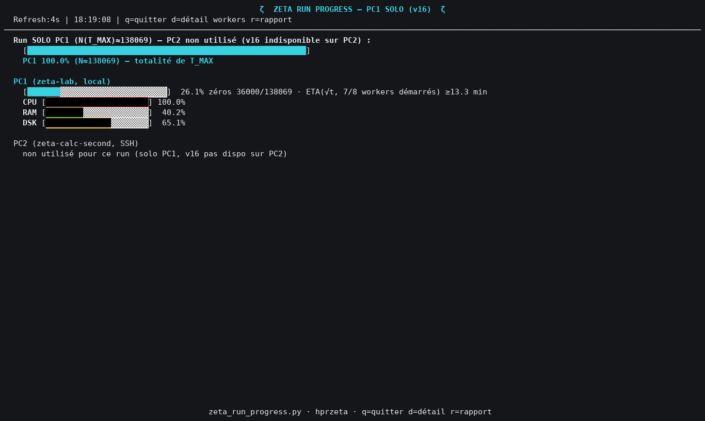

# Rapport d'écran — ZETA RUN PROGRESS

Capture du 2026-10-18 18:19:10 · log lu : `run_T100000_20261018_181813.log` · **[mesuré]** = lu dans le log ou à l'écran ; **[critère]** = règle fixée par ce rapport et affichée ; **[code]** = comportement lu dans `zeta_run_progress.py` / `compute_zeros_v16.py`.

## 1. Verdict : ⚠ À SURVEILLER

- **Sain** = aucune anomalie de niveau « critique » ni « à surveiller » ; les notes « info » (ex. rescan) ne comptent pas **[critère]**.
- Critiques : id de worker hors 0..n_segments−1 · même t pour deux workers · total des principaux > N(T_MAX).
- À surveiller : worker sans palier lu · rescan d'un segment inexistant.
- Info seulement (pas de verdict) : rescan connu · total brut incluant le rescan · écart d'avancement entre workers (normal en cours de run : vitesses différentes) **[critère]**.

| Niveau | Contrôle automatique |
|---|---|
| À SURVEILLER | Worker 7 (segment [88722.8 ; 100000.0]) : aucun palier lu dans le log — normal au démarrage (< 1000 zéros), anormal si les autres workers sont déjà avancés. |
| info | Écart de 11000 zéros entre le worker le plus et le moins avancé : normal en cours de run (les segments ont le même nombre de zéros attendu, mais les workers n'avancent pas à la même vitesse) ; à comparer au bilan final, où tous doivent converger. |

### Contrôles effectués

- worker manquant (segment annoncé sans aucun palier)
- id hors plage 0..n_segments−1
- doublon de t entre workers
- total des workers principaux > N(T_MAX)
- écart d'avancement entre workers (information)

***2. Capture de l'écran** — ZETA RUN PROGRESS à l'instant de la touche r (rendu depuis les appels d'affichage enregistrés).*

## 3. Les chiffres de CE run

| Grandeur | Valeur |
|---|---|
| N(T_MAX) attendu | 138069 [mesuré, lu dans l'en-tête du log] |
| Segments (workers principaux) | 8 |
| Zéros comptés (principaux, paliers) | 36000 |
| Zéros comptés (tous ids, rescan inclus) | 36000 |
| Avancement | 26.1 % |
| Rescans présents | aucun |
| ETA(√t) | 13.3 min |

### Détail par worker

| Worker | Segment [a ; b] | Palier (zéros) | t du dernier zéro | Écoulé (s) | z/s | Avancement |
|---|---|---|---|---|---|---|
| W0 | [14 ; 15867] | 3000 | 3533 | 47.6 | 63 | 22 % |
| W1 | [15867 ; 29142] | 6000 | 20597 | 48.8 | 123 | 36 % |
| W2 | [29141 ; 41705] | 7000 | 34300 | 46.9 | 149 | 41 % |
| W3 | [41704 ; 53842] | 4000 | 44549 | 48.5 | 82 | 23 % |
| W4 | [53842 ; 65682] | 12000 | 62101 | 46.3 | 259 | 70 % |
| W5 | [65682 ; 77295] | 1000 | 66360 | 47.6 | 21 | 6 % |
| W6 | [77294 ; 88723] | 3000 | 79293 | 48.8 | 61 | 17 % |

**z/s** = palier ÷ temps écoulé au dernier palier lu, calculé par ce rapport **[critère]** ; **Avancement** = (t − a) ÷ (b − a) dans le segment du worker **[critère]**.

## 4. Lecture de chaque élément de l'écran

- **Titre** : « PC1 SOLO (v16) » si le log `run_T*_*.log` est plus récent que `distribute_T*_*.log`, sinon « PC1/PC2 » (détection par date de modification, `draw()`) **[code]**.
- **Barre globale** (en haut) : mode solo = bandeau plein « PC1 100 % — totalité de T_MAX », N(T_MAX) lu dans la ligne « N zéros ≈ … » du log (`parse_solo_header`). Mode distribué = répartition cible PC1/PC2 de N(T_MAX) lue dans le log maître **[code]**.
- **Barres PC1 / PC2** : « zéros X/Y » = X : somme des paliers des workers principaux · Y : zéros assignés à la machine ; le pourcentage = 100·X/Y plafonné à 100 **[code]**.
- **ETA(√t)** : temps restant du PIRE worker, en supposant un coût par zéro ∝ √t, soit coût(a→b) ∝ (2/3)(b^1,5 − a^1,5) (`eta_sqrt_weighted`) **[code]**. Variante « n/N workers démarrés » : tous les workers n'ont pas encore écrit de palier, l'estimation ne porte que sur les workers démarrés et peut être trop optimiste (« ≥ »). « ETA(lin, optimiste) » : règle de trois, utilisée seulement sans données par worker.
- **CPU / RAM / DSK** : sonde toutes les 4 s (locale pour PC1, SSH pour PC2). CPU = écart de `/proc/stat` sur 0,4 s ; RAM = (MemTotal − MemAvailable)/MemTotal ; DSK = occupation de `/` (statvfs). Couleur : vert < 60 %, jaune < 85 %, rouge au-delà (`load_pct_color`) **[code]**.
- **PC2** : en mode solo, affichée en grisé « non utilisé pour ce run (solo PC1, v16 pas dispo sur PC2) » — c'est un choix du code, pas une panne **[code]**.
- **Détail workers (touche d)** : une entrée par worker, voir ci-dessous.

### Signification exacte de « W3:#17000@t=53662 »

- **W3** : worker n°3 (rang dans l'ordre des ids ; l'id brut est ajouté entre parenthèses s'il diffère) **[code]**.
- **#17000** : nombre de zéros trouvés PAR CE WORKER dans SON segment, arrondi au millier inférieur : le moteur n'écrit une ligne qu'aux paliers `(n // 1000) × 1000` (`compute_zeros_v16.py:291`) — c'est un **nombre de zéros**, pas un t **[code]**.
- **t=53662** : partie imaginaire t du DERNIER zéro trouvé par ce worker (`zeros_segment[-1]`), arrondie à l'entier ; sans unité (ordonnée sur la droite critique Re(s)=½) **[code]**.
- Le temps écoulé (« — 20,3s » dans le log) est en **secondes depuis le démarrage de ce worker** **[code]**.
- **R5(id105)** : rescan ciblé du segment 5 (STEP/2), id = 100 + 5 ; il apparaît sur une ligne « rescan » à part.

## 5. Interprétation

- **Équilibrage** : paliers de 1000 à 12000 zéros (écart 11000) ; le moteur découpe [T_MIN ; T_MAX] en segments à nombre de zéros attendu comparable (`_partitionner_adaptatif`), donc des paliers voisins sont NORMAUX **[mesuré]**.
- **Vitesse** : de 21 à 259 z/s selon le worker (les segments hauts coûtent plus par zéro, coût ∝ √t) **[mesuré]**.
- **Dépassement** : aucun, total principal 36000 ≤ N(T_MAX) 138069 **[mesuré]**.
- **PC2 non utilisé** : en mode solo le code n'attribue rien à PC2 (la v16 n'est pas disponible sur PC2) **[code]**.

## 6. Glossaire

| Terme | Débutant | Expert |
|---|---|---|
| Zéro | Valeur de t où la fonction zêta de Riemann s'annule sur la droite critique. | ζ(½+it) = 0 ; ici zéros non triviaux, comptés par N(T). |
| N(T_MAX) | Combien de zéros on s'attend à trouver jusqu'à T_MAX. | Riemann–von Mangoldt : N(T) ≈ (T/2π)·ln(T/2πe) + 7/8 (heuristique de comptage, vérifiée par Turing). |
| Worker | Un processus qui calcule une tranche de t. | Process du Pool multiprocessing, un segment [a ; b] chacun (fork). |
| Palier | Le compteur n'avance que par milliers. | Journalisation `(n//1000)*1000` du moteur v16. |
| Rescan | Deuxième passage plus fin sur une tranche où il manquait un zéro. | Rescan à STEP/2 des segments en déficit (déphasage de grille), id 100+segment. |
| ETA(√t) | Temps restant estimé, en tenant compte que le calcul ralentit quand t monte. | Extrapolation du coût ∫√t dt par worker, max sur les workers. |
| Illinois / Arb | Méthode d'affinage numérique d'un zéro. | Secante modifiée, Arb/FLINT double précision (`illinois_refine_arb`). |
| Turing | Test de complétude du nombre de zéros trouvés. | Vérification numérique via N(T) et la fonction S(T) ; pas une preuve. |

---
*progress_rapport_20261018_181910.md · MAJ 2026-10-18 · 94 lignes*
