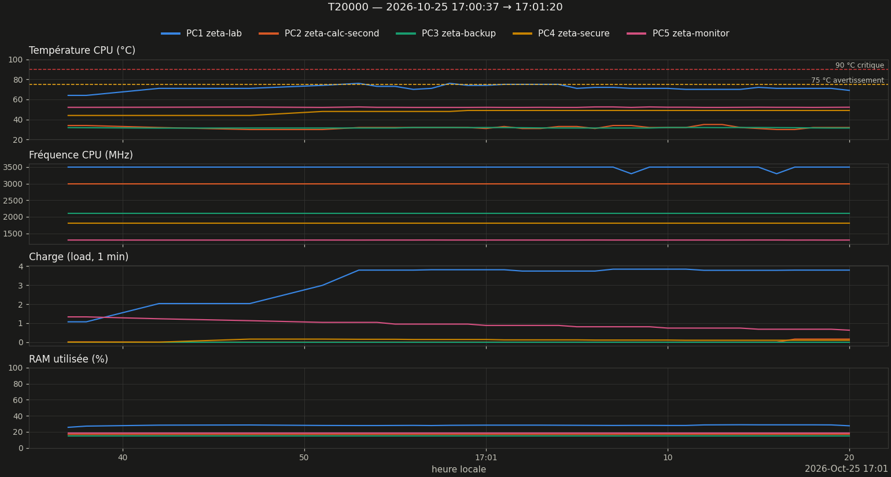
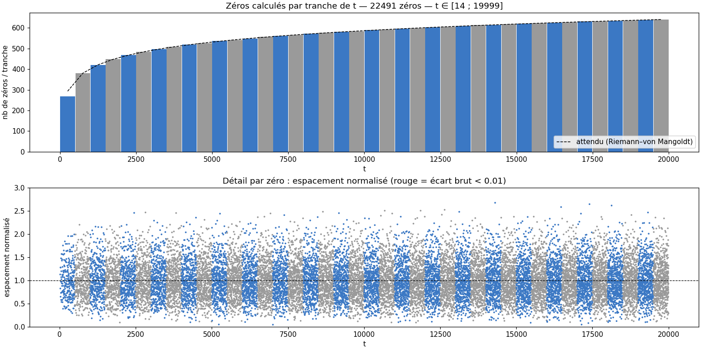
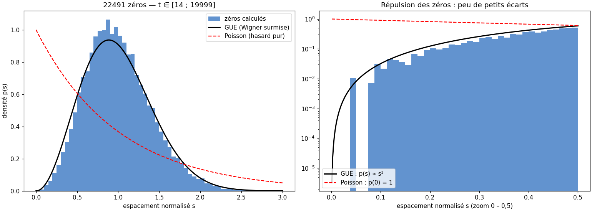
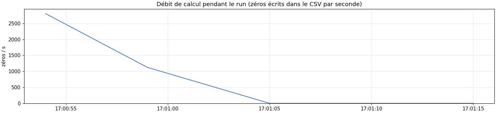

# Monitoring report — run T20000

Legend: **[measured]** = figure read from data; **[heuristic]** / **[hypothesis]** = unverified interpretation; **[conjecture]** = unproven result.

**Turing–Backlund validation: ✅ COMPLET** [measured, read from execution_v16_T20000_20261025_170038.log] — numerical check, not a certification.

## 1. Summary

| Item | Value |
|---|---|
| Run | 20261025_170037_T20000  (prod) |
| Start / end | 2026-10-25 17:00:37 → 17:01:20 |
| Duration | 0min43s |
| Command (excerpt) | `bash -c printf '20000\nO\n' \| python /home/riemann/projet_zeta/src/calculs/optimisation/co` |
| Exit code | 0 |
| CPU turbo start → end | actif (intel_pstate) → actif (intel_pstate) |
| Zeros CSV | `zeros_v16_T20000_20261025_170038.csv` |
| Turing–Backlund | ✅ COMPLET |
| Zeros in CSV | 22491  [measured] |
| t min → t max | 14.135 → 19999.276 |
| Average rate (zeros / run duration) | 523.0 /s |

## 2. Machines during the run

*Figure 1 — Temperature, frequency, load and RAM of the 5 machines (1 sample/s).*

| Machine | Valid | T moy °C | T max °C | % ≥ 75 °C | MHz min–max | load max | RAM max % |
|---|---|---|---|---|---|---|---|
| PC1 zeta-lab | 100 % | 71.6 | 76.0 | 18 | 3300–3500 | 3.84 | 28.8 |
| PC2 zeta-calc-second | 100 % | 32.1 | 35.0 | 0 | 2992–2992 | 0.16 | 16.9 |
| PC3 zeta-backup | 100 % | 31.7 | 32.0 | 0 | 2100–2100 | 0.00 | 15.2 |
| PC4 zeta-secure | 100 % | 48.2 | 49.0 | 0 | 1800–1800 | 0.16 | — |
| PC5 zeta-monitor | 100 % | 52.1 | 52.5 | 0 | 1297–1299 | 1.33 | 18.6 |

### Observations

- PC1: max temperature 76.0 °C, 18 % of time ≥ 75 °C (warning threshold) [measured]

## 3. Computed zeros

*Figure 2 — Top: zeros per t-slice (alternating blue/grey) vs theoretical density ln(t/2π)/2π. Bottom: normalized spacing of each zero.*

Count: 22491 zeros in the CSV; Riemann–von Mangoldt formula (without the S(t) term): ≈ 22491.0. Difference -0.0. **[heuristic]** a difference of a few units is normal; tens suggest missing or duplicated zeros. **This is not a validation: completeness is checked by Turing–Backlund (verdict at the top of this report).**

*Figure 3 — Normalized spacings vs GUE (Wigner surmise) and Poisson; right: zoom on repulsion (log scale).*

| Item | Measured | Reference |
|---|---|---|
| Mean of s | 1.0000 | 1 (by construction) |
| Variance of s | 0.1569 | GUE ≈ 0.18 ; Poisson = 1 |
| Share s < 0.1 | 0.062 % | GUE surmise ≈ 0.11 % ; Poisson ≈ 9.5 % |
| Smallest raw gap | 0.035307 | — |

**[conjecture, Montgomery–Odlyzko]** spacings follow GUE; here the repulsion is clear. A variance slightly below 0.18 at moderate heights is attributed to finite-size corrections **[hypothesis]**. With few zeros (< a few thousand) the histogram is noisy: do not over-interpret.

*Figure 4 — Throughput (zeros/s) over the run, to compare with PC1 frequency and temperature (figure 1).*

- Instantaneous throughput not usable: the zeros CSV grew on only 40 % of the samples (written per worker at the end); rely on the mean throughput in the summary [measured]

## 4. Session sheet

| Item | Value |
|---|---|
| CPU | Intel(R) Core(TM) i7-7500U CPU @ 2.70GHz (4 threads) |
| Governor / turbo | performance / actif (intel_pstate) |
| Git | 72bb991 @ Riemann_Lab_IA (35 modified files) |
| Load / free RAM at start | 1.07 / 11.6 Go |
| Detailed file | `session.md` |

## 5. Interpretation

*Written by Claude Code from the figures above — to be validated.*

- **[mesuré]** 22 491 zéros, validation Turing–Backlund COMPLET, écart à la formule de Riemann–von Mangoldt : −0,0.
- **[mesuré]** Durée suivie 43 s ; `time` 52 s : l'écart de 9 s est identique sur quatre runs (T=20000 et T=200000).
- **[mesuré]** PC1 à 75 °C ou plus pendant 18 % du run (maximum 76 °C) ; PC2 à PC5 inactives.
- **[mesuré]** Variance des espacements normalisés 0,1569 (GUE : environ 0,18) ; 0,1614 pour T=100 000 et 0,1693 vers t = 5·10^6. **[hypothèse]** effet de hauteur finie, non démontré.
- **[hypothèse]** Ce run est 16 % plus long que celui du 24/10 22:56 (43 s contre 37 s) alors que sa température maximale est plus basse (76 °C contre 77 °C) : la température seule ne l'explique pas ; cause inconnue.

## 6. Limits

- Samples about every 1 s (SSH): shorter spikes are missed; PC4 (OpenBSD) has no RAM reading.
- Run start/end = detected process appearing/disappearing, within a few seconds.
- Beyond 8,000 points per machine the plot is subsampled (statistics use all samples).

---
*report_en.md · MAJ 2026-10-25 · 95 lignes*
