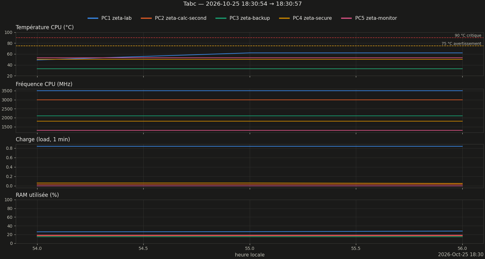

# Rapport de monitoring — run Tabc

Légende : **[mesuré]** = chiffre lu dans les données ; **[heuristique]** / **[hypothèse]** = interprétation non vérifiée ; **[conjecture]** = résultat non démontré.

Validation Turing–Backlund : verdict introuvable (journal `execution_*.log` absent ou illisible) [non vérifié].

## 1. Résumé

| Grandeur | Valeur |
|---|---|
| Run | 20261025_183054_Tabc  (prod) |
| Début / fin | 2026-10-25 18:30:54 → 18:30:57 |
| Durée | 0min03s |
| Commande (extrait) | `bash -c printf 'abc\nO\n' \| python /home/riemann/projet_zeta/src/calculs/optimisation/comp` |
| Code retour | 1 |
| Turbo CPU début → fin | actif (intel_pstate) → actif (intel_pstate) |
| CSV des zéros | `introuvable` |
| Turing–Backlund | inconnu |

## 2. Machines pendant le run

*Figure 1 — Température, fréquence, charge et RAM des 5 machines (1 mesure/s).*

| Machine | Valides | T moy °C | T max °C | % ≥ 75 °C | MHz min–max | load max | RAM max % |
|---|---|---|---|---|---|---|---|
| PC1 zeta-lab | 100 % | 57.7 | 62.0 | 0 | 3500–3500 | 0.84 | 27.8 |
| PC2 zeta-calc-second | 100 % | 33.0 | 33.0 | 0 | 2992–2992 | 0.03 | 17.0 |
| PC3 zeta-backup | 100 % | 33.0 | 33.0 | 0 | 2100–2100 | 0.00 | 15.2 |
| PC4 zeta-secure | 100 % | 50.0 | 50.0 | 0 | 1800–1800 | 0.06 | — |
| PC5 zeta-monitor | 100 % | 53.2 | 53.2 | 0 | 1297–1298 | 0.00 | 18.8 |

### Observations

- Rien d'anormal détecté sur les seuils automatiques [mesuré].

## 3. Zéros calculés

CSV des zéros introuvable ou trop court : sections 3 non générées. Relancer `zeta-report` après `zeta-run-hint NOM CSV`.

## 4. Fiche de session

| Élément | Valeur |
|---|---|
| CPU | Intel(R) Core(TM) i7-7500U CPU @ 2.70GHz (4 threads) |
| Gouverneur / turbo | performance / actif (intel_pstate) |
| Git | 72bb991 @ Riemann_Lab_IA (44 fichiers modifiés) |
| Charge / RAM dispo au départ | 0.84 / 11.5 Go |
| Fichier détaillé | `session.md` |

## 5. Interprétation

*Pas encore rédigée. Après relecture des observations, créer `interpretation.md` dans ce dossier puis `zeta-report` : distinguer mesuré / heuristique / hypothèse / conjecture.*

## 6. Limites

- Mesures toutes les ~1 s (SSH) : les pics plus courts échappent ; PC4 (OpenBSD) n'a pas de mesure de RAM.
- Début/fin du run = apparition/disparition du processus détecté, à quelques secondes près.
- Au-delà de 8 000 points par machine, le tracé est sous-échantillonné (les statistiques utilisent toutes les mesures).

---
*rapport.md · MAJ 2026-10-25 · 63 lignes*
