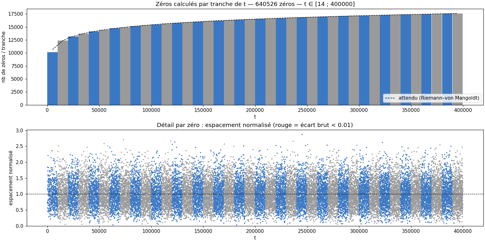
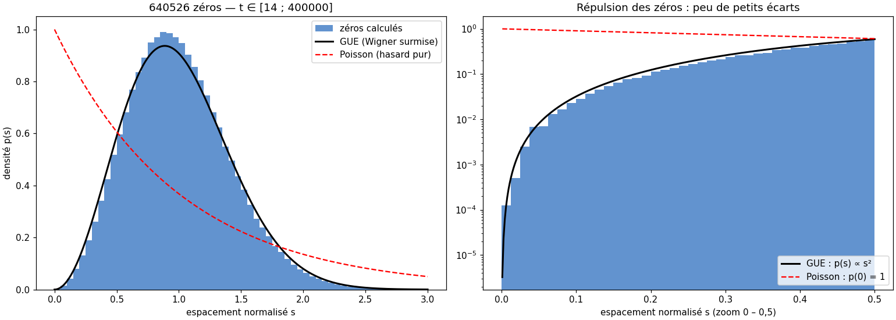
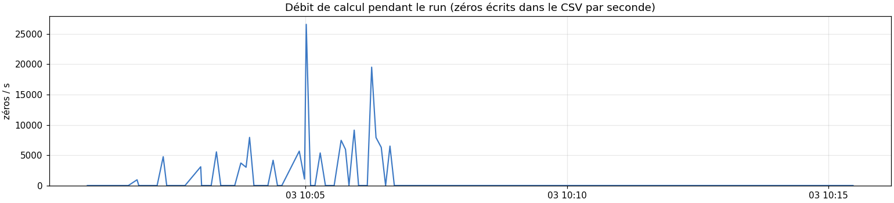

# Rapport de monitoring — run T400000

Légende : **[mesuré]** = chiffre lu dans les données ; **[heuristique]** / **[hypothèse]** = interprétation non vérifiée ; **[conjecture]** = résultat non démontré.

**⚠ ALERTE — Validation Turing–Backlund : ❌ INCOMPLET** — 3 zéro(s) manquant(s) [mesuré, lu dans execution_v17_T400000_20261103_095511.log]. Les comptages de ce run ne sont PAS complets : ne pas utiliser ces zéros pour une statistique sans les compléter.

- `T=50372.17  calc= 64052  attendus= 64052  delta=   +0  ✅ OK`
- `T=114227.16  calc=160130  attendus=160130  delta=   +0  ✅ OK`
- `T=213326.92  calc=320261  attendus=320261  delta=   +0  ✅ OK`
- `T=308000.36  calc=480392  attendus=480394  delta=   +2  ❌ MANQUE 2`
- `T=399999.68  calc=640523  attendus=640526  delta=   +3  ❌ MANQUE 3`

## 1. Résumé

| Grandeur | Valeur |
|---|---|
| Run | 20261103_095447_T400000  (prod) |
| Début / fin | 2026-11-03 09:54:47 → 10:15:33 |
| Durée | 20min46s |
| Commande (extrait) | `bash -c printf '400000\nO\n' \| python /home/riemann/projet_zeta/src/calculs/optimisation/c` |
| Code retour | 0 |
| Turbo CPU début → fin | actif (intel_pstate) → actif (intel_pstate) |
| CSV des zéros | `zeros_v17_T400000_20261103_095511.csv` |
| Turing–Backlund | ❌ INCOMPLET |
| Zéros dans le CSV | 640526  [mesuré] |
| t min → t max | 14.135 → 399999.681 |
| Débit moyen (zéros / durée du run) | 514.1 /s |

## 2. Machines pendant le run

Aucune mesure machine sur cette période (logger arrêté ? `zeta-mon-on`).

## 3. Zéros calculés

*Figure 2 — Haut : zéros par tranche de t (bleu/gris alternés) vs densité théorique ln(t/2π)/2π. Bas : espacement normalisé de chaque zéro.*

Comptage : 640526 zéros dans le CSV ; formule de Riemann–von Mangoldt (sans terme S(t)) : ≈ 640525.8. Écart +0.2. **[heuristique]** un écart de quelques unités est normal ; un écart de plusieurs dizaines suggère des zéros manquants ou en double. **Ce n'est pas une validation : la complétude se vérifie par Turing–Backlund (verdict en tête de ce rapport).**

*Figure 3 — Espacements normalisés vs GUE (Wigner surmise) et Poisson ; à droite zoom sur la répulsion (échelle log).*

| Grandeur | Mesuré | Référence |
|---|---|---|
| Moyenne de s | 1.0000 | 1 (par construction) |
| Variance de s | 0.1643 | GUE ≈ 0.18 ; Poisson = 1 |
| Part s < 0,1 | 0.087 % | GUE surmise ≈ 0.11 % ; Poisson ≈ 9.5 % |
| Plus petit écart brut | 0.005704 | — |

**[conjecture, Montgomery–Odlyzko]** les espacements suivent la loi GUE ; ici la répulsion est nette. La variance un peu sous 0,18 sur de petites hauteurs relève des corrections de taille finie **[hypothèse]**. Avec peu de zéros (< quelques milliers) l'histogramme est bruité : ne pas sur-interpréter.

*Figure 4 — Débit (zéros/s) au cours du run, à comparer à la fréquence et à la température de PC1 (figure 1).*

- Débit instantané non exploitable : le CSV des zéros n'a grossi que sur 11 % des mesures (écriture par worker en fin de calcul) ; se fier au débit moyen du résumé [mesuré]

## 4. Fiche de session

| Élément | Valeur |
|---|---|
| CPU | Intel(R) Core(TM) i7-7500U CPU @ 2.70GHz (4 threads) |
| Gouverneur / turbo | performance / actif (intel_pstate) |
| Git | 43134dd @ Riemann_Lab_IA (49 fichiers modifiés) |
| Charge / RAM dispo au départ | 2.42 / 11.5 Go |
| Fichier détaillé | `session.md` |

## 5. Interprétation

*Rédigée par Claude Code à partir des chiffres ci-dessus — à valider.*

Note de correction — 2026-11-03 (postérieure au run)

L'alerte « INCOMPLET — 3 zéros manquants » en tête de rapport est lue dans le journal d'exécution du run, qui n'a pas été modifié : elle décrit l'état du run à sa fin (640 523 zéros). Elle est corrigée par la présente note.

- [mesuré] Les 3 zéros manquants sont t = 286 692,10233507601 et 306 086,79828720580 (segment 5, worker 5), et t = 385 415,72427039186 (segment 7, worker 7). Chacun figurait dans le journal d'échecs (checkpoints/echecs_worker_005 et 007) : l'affinage n'avait pas convergé.
- [mesuré] Dans chacun des 3 brackets, Z (mpmath.siegelz, 30 chiffres) ne change pas de signe : le zéro se trouve à environ 2,5e-7 à l'extérieur du bracket. Il a été affiné avec mpmath.siegelz + Illinois, avec |Z(t)| de l'ordre de 1e-29.
- [mesuré] Les 3 zéros ont été ajoutés au CSV (methode_affinage = siegelz_manuel, colonne n renumérotée) : 640 526 zéros. Sauvegarde : zeros_v17_T400000_20261103_095511.csv.bak-20261103.
- [mesuré] Turing–Backlund relancé sur le CSV corrigé (valider_turing, dps=30) : COMPLET, 0 manquant aux 5 points de contrôle (T_max = 399 999,68 : 640 526 calculés pour 640 526 attendus). Les points intermédiaires diffèrent du run d'origine car ils sont choisis par rang dans la liste.
- [hypothèse] Le décalage commun (environ 2,5e-7) des bords de brackets pourrait venir de l'erreur float64 de la détection de signe à t proche de 3e5 ; non testé.
- Non corrigés : execution_v17_*.log et le CSV principal (avant rescan) restent ceux du run d'origine. Le verdict en tête de rapport (INCOMPLET) vient de ce journal. Le comptage de la section 3 (640 526) reflète en revanche le CSV corrigé.

Conséquence : le CSV corrigé est complet selon Turing ; le run d'origine, lui, ne l'était pas.

## 6. Limites

- Mesures toutes les ~1 s (SSH) : les pics plus courts échappent ; PC4 (OpenBSD) n'a pas de mesure de RAM.
- Début/fin du run = apparition/disparition du processus détecté, à quelques secondes près.
- Au-delà de 8 000 points par machine, le tracé est sous-échantillonné (les statistiques utilisent toutes les mesures).

---
*rapport.md · MAJ 2026-11-03 · 94 lignes*
