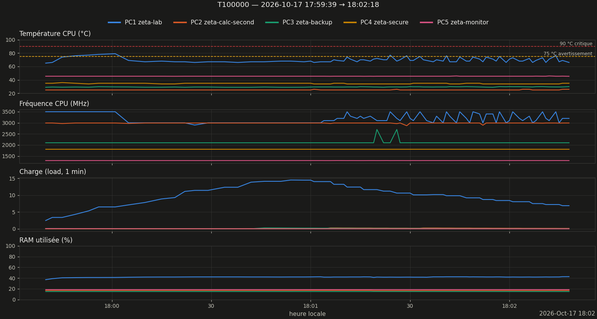
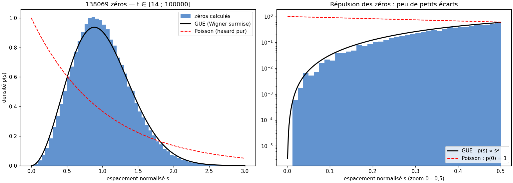
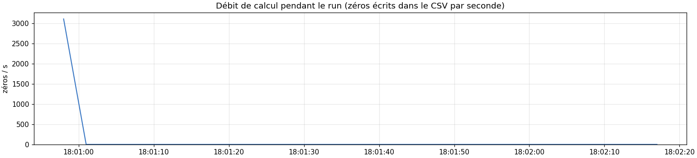

# Rapport de monitoring — run T100000

Légende : **[mesuré]** = chiffre lu dans les données ; **[heuristique]** / **[hypothèse]** = interprétation non vérifiée ; **[conjecture]** = résultat non démontré.

## 1. Résumé

| Grandeur | Valeur |
|---|---|
| Run | 20261017_175939_T100000  (test) |
| Début / fin | 2026-10-17 17:59:39 → 18:02:18 |
| Durée | 2min39s |
| Commande (extrait) | `bash -c printf '100000\nO\n' \| python /home/riemann/projet_zeta/src/calculs/optimisation/c` |
| Code retour | 0 |
| Turbo CPU début → fin | actif (intel_pstate) → actif (intel_pstate) |
| CSV des zéros | `zeros_v16_T100000_20261017_175940.csv` |
| Zéros dans le CSV | 138069  [mesuré] |
| t min → t max | 14.135 → 99999.701 |
| Débit moyen (zéros / durée du run) | 868.4 /s |

## 2. Machines pendant le run

*Figure 1 — Température, fréquence, charge et RAM des 5 machines (1 mesure/s).*

| Machine | Valides | T moy °C | T max °C | % ≥ 75 °C | MHz min–max | load max | RAM max % |
|---|---|---|---|---|---|---|---|
| PC1 zeta-lab | 100 % | 69.7 | 79.0 | 13 | 2900–3500 | 14.49 | 42.6 |
| PC2 zeta-calc-second | 100 % | 25.1 | 26.0 | 0 | 2870–2993 | 0.29 | 16.9 |
| PC3 zeta-backup | 100 % | 29.5 | 30.0 | 0 | 2100–2700 | 0.27 | 15.2 |
| PC4 zeta-secure | 100 % | 34.5 | 36.0 | 0 | 1800–1800 | 0.05 | — |
| PC5 zeta-monitor | 100 % | 45.5 | 45.9 | 0 | 1297–1299 | 0.06 | 18.3 |

### Observations

- PC1 : température max 79.0 °C, 13 % du temps ≥ 75 °C (seuil d'avertissement) [mesuré]
- PC1 : fréquence médiane 3000 MHz sur le 1ᵉʳ cinquième du run, 3200 MHz sur le dernier [mesuré]

## 3. Zéros calculés

*Figure 2 — Haut : zéros par tranche de t (bleu/gris alternés) vs densité théorique ln(t/2π)/2π. Bas : espacement normalisé de chaque zéro.*

Comptage : 138069 zéros dans le CSV ; formule de Riemann–von Mangoldt (sans terme S(t)) : ≈ 138068.6. Écart +0.4. **[heuristique]** un écart de quelques unités est normal ; un écart de plusieurs dizaines suggère des zéros manquants ou en double. **Ce n'est pas une validation : la complétude se prouve par Turing–Backlund, hors de ce rapport.**

*Figure 3 — Espacements normalisés vs GUE (Wigner surmise) et Poisson ; à droite zoom sur la répulsion (échelle log).*

| Grandeur | Mesuré | Référence |
|---|---|---|
| Moyenne de s | 1.0000 | 1 (par construction) |
| Variance de s | 0.1614 | GUE ≈ 0.18 ; Poisson = 1 |
| Part s < 0,1 | 0.073 % | GUE surmise ≈ 0.11 % ; Poisson ≈ 9.5 % |
| Plus petit écart brut | 0.014705 | — |

**[conjecture, Montgomery–Odlyzko]** les espacements suivent la loi GUE ; ici la répulsion est nette. La variance un peu sous 0,18 sur de petites hauteurs relève des corrections de taille finie **[hypothèse]**. Avec peu de zéros (< quelques milliers) l'histogramme est bruité : ne pas sur-interpréter.

*Figure 4 — Débit (zéros/s) au cours du run, à comparer à la fréquence et à la température de PC1 (figure 1).*

- Débit instantané non exploitable : le CSV des zéros n'a grossi que sur 6 % des mesures (écriture par worker en fin de calcul) ; se fier au débit moyen du résumé [mesuré]

## 4. Fiche de session

| Élément | Valeur |
|---|---|
| CPU | Intel(R) Core(TM) i7-7500U CPU @ 2.70GHz (4 threads) |
| Gouverneur / turbo | performance / actif (intel_pstate) |
| Git | 2de45af @ Riemann_Lab_IA (27 fichiers modifiés) |
| Charge / RAM dispo au départ | 2.46 / 9.8 Go |
| Fichier détaillé | `session.md` |

## 5. Interprétation

*Rédigée par Claude Code à partir des chiffres ci-dessus — à valider.*

### Calcul

- **[mesuré]** 138 069 zéros pour T = 100 000, contre ≈ 138 068,6 par la formule de Riemann–von Mangoldt (écart +0,4). Score LMFDB 20/20 à moins de 10⁻⁹. Validation de Turing : « complet ».
- **[heuristique]** L'accord du comptage avec la formule indique qu'aucun zéro n'est manqué sur cet intervalle. Il ne le démontre pas : le rapport ne remplace pas une validation Turing–Backlund certifiée.

### Machine

- **[mesuré]** PC1 : température moyenne 69,7 °C, maximum 79,0 °C, 13 % du temps au-dessus de 75 °C. Fréquence médiane 3 000 MHz sur le 1ᵉʳ cinquième du run, 3 200 MHz sur le dernier. Charge maximale 14,49. Aucune erreur de lancement.
- **[hypothèse]** La fréquence basse en début de run (2 900 à 3 000 MHz) pourrait venir de la montée en température et de la charge simultanée des 4 threads. Aucune mesure ici ne l'établit : le run ne dure que 97 s de calcul.
- **[mesuré]** PC2 à PC5 sont restés inactifs (charge ≤ 0,3, température ≤ 46 °C) : le run n'a utilisé que PC1.

### Statistique des espacements

- **[mesuré]** Variance des espacements normalisés 0,1614 ; part des espacements inférieurs à 0,1 : 0,073 %.
- **[conjecture, Montgomery–Odlyzko]** Les espacements suivent la loi GUE. La répulsion observée est cohérente avec elle et très loin de Poisson (variance 1, part inférieure à 0,1 de 9,5 %).
- **[hypothèse]** L'écart entre 0,1614 et 0,18 s'expliquerait par des corrections de taille finie à ces hauteurs. Non vérifié ici.

### Limites de ce run

- **[mesuré]** La version v16 écrit le CSV de chaque worker seulement à la fin de ce worker : le débit instantané (`etat.csv`) vaut 0 presque partout et n'est pas exploitable. Seul le débit moyen (868 z/s) est fiable.
- **[mesuré]** Un seul run de test, un seul passage : aucune comparaison avec un autre run, donc aucune conclusion sur la variabilité d'un run à l'autre.

## 6. Limites

- Mesures toutes les ~1 s (SSH) : les pics plus courts échappent ; PC4 (OpenBSD) n'a pas de mesure de RAM.
- Début/fin du run = apparition/disparition du processus détecté, à quelques secondes près.
- Au-delà de 8 000 points par machine, le tracé est sous-échantillonné (les statistiques utilisent toutes les mesures).

---
*rapport.md · MAJ 2026-10-17 · 109 lignes*
